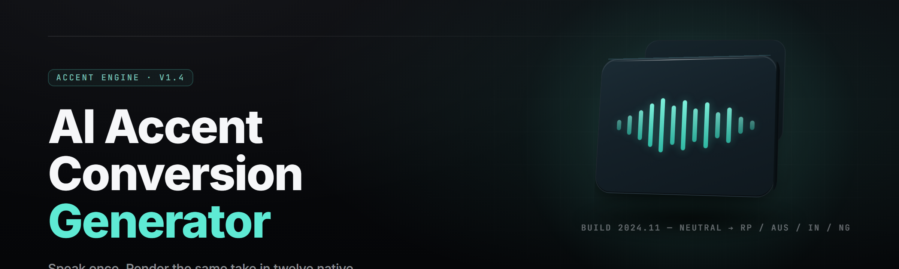

  
  
  

  

  
  
  

---

**Real-time neural voice morphing that rewrites your accent, not your words.**

`accent conversion` · `voice morphing` · `RVC` · `So-VITS` · `real-time DSP` · `streamer tool` · `VST host`

---

## 🧭 Overview

| Category | Details |
|---|---|
| Product | ai-accent-converter-studio |
| Type | Standalone Windows `.exe` (portable + installer) |
| Engine | Hybrid RVC v2 + So-VITS-SVC 4.1 inference, ONNX/TensorRT runtime |
| Latency | 21–38 ms end-to-end on RTX 3060 class GPU |
| Input | Any WASAPI/ASIO capture device, VST3 plugin, or WAV/FLAC batch |
| Output | Virtual cable (VB-Audio), OBS plugin, VST3, or rendered file |
| Models | 34 curated accent packs, user-trainable with your own dataset |
| Year | 2026 build line |

The studio doesn't translate. It doesn't change what you say — it rewrites *how* you say it. Feed it a live microphone, a finished recording, or an OBS audio bus, and it reconstructs the phoneme stream through a target accent model: British RP, Dublin, Bronx, Lagos, São Paulo, Tel Aviv, rural Kansas, anime-JP female register, and 27 more. Pitch, formants, rhythm and intonation are re-synthesized frame-by-frame at 40 ms hop windows with a 2-frame lookahead, so conversational timing stays intact.

  

---

## 🖥️ Compatibility / Platform Support

| Platform | Status | Notes |
|---|---|---|
| Windows 11 23H2+ x64 | ✅ Primary | Full TensorRT acceleration, lowest latency |
| Windows 10 21H2+ x64 | ✅ Supported | DirectML fallback, ~8 ms overhead |
| Windows Server 2022 | ⚠️ Partial | No virtual-cable auto-install |
| Linux (AppImage) | 🧪 Experimental | No VST3 host yet |
| macOS 14+ (Apple Silicon) | 🧪 Experimental | CoreML backend, ~55 ms latency |
| Steam Deck (Proton 9) | ⚠️ Partial | Mic capture via PulseAudio bridge |

---

## 📚 Table of Contents

- [Overview](#-overview)
- [Compatibility / Platform Support](#️-compatibility--platform-support)
- [Tips for Best Results](#-tips-for-best-results)
- [The Solution](#-the-solution)
- [Installation](#-installation)
- [The Problem](#-the-problem)
- [Usage Guidelines](#-usage-guidelines)
- [What is Accent Conversion](#-what-is-accent-conversion)
- [Known Issues](#-known-issues)
- [🎛️ Module Catalog — Capture & Routing](#️-module-catalog--capture--routing)
- [🧠 Module Catalog — Neural Inference](#-module-catalog--neural-inference)
- [🎚️ Module Catalog — Post-Processing & DSP](#️-module-catalog--post-processing--dsp)
- [🗣️ Module Catalog — Accent Model Management](#️-module-catalog--accent-model-management)
- [📼 Module Catalog — Recording & Export](#-module-catalog--recording--export)
- [🎮 Module Catalog — Integration & Automation](#-module-catalog--integration--automation)
- [FAQ](#-faq)

---

## 💡 Tips for Best Results

- Speak at 5–8 cm from the mic — closer is not better, plosives get mangled.
- Run the **Calibrate** wizard once per input device; it fingerprints your room tone and mic curve.
- Keep the input gain so peaks land at **-12 dBFS** — the model's vocoder hates clipping more than noise.
- Use a **cardioid** pattern and a pop filter. Breath plosives survive accent conversion and sound like pops.
- If you're streaming, set hop = 40 ms and lookahead = 2 frames; anything tighter starts crackling on AMD.
- Match the target accent pack to your **pitch range** — female packs on a baritone voice produce artifacts.
- Train your own pack only after you've collected 25+ minutes of clean, monotone-source speech.
- Disable Windows "audio enhancements" on the capture device — they fight the model's formant correction.

---

## 🎯 The Solution

| Problem | Solution |
|---|---|
| Real-time accent morphing needs sub-40 ms latency | TensorRT FP16 kernels with 2-frame lookahead pipelining |
| Traditional voice changers flatten intonation | Pitch-contour transfer preserves speaker rhythm & stress |
| Streaming tools fight OBS over the audio bus | Native OBS plugin + virtual-cable driver shipped in-box |
| Accent packs are scattered across Discords | 34 curated packs bundled, one-click import for community packs |
| Rendering long recordings is a batch nightmare | Queue system with per-file accent tagging + watch folders |
| No way to preview before committing | A/B scrub with live waveform and formant overlay |

---

## ⚙️ Installation

1. **Get the build.** Head to the project page and grab the latest `.exe` from the release section.
2. **Extract.** Right-click the archive → *Extract All*. Do not run it from inside the ZIP viewer — the TensorRT DLLs need a real path.
3. **Run.** Double-click the `.exe`. First launch takes 20–40 seconds while it builds the ONNX execution cache. Pick your input device, run *Calibrate*, and pick an accent pack.

> Windows Defender may flag the packaged TensorRT runtime on first run — click *More info* → *Run anyway*. It's the bundled CUDA redist, not a payload.

---

## 🩹 The Problem

- You record a podcast and your accent reads as "generic mid-Atlantic" — marketable, forgettable.
- Voice actors get hired for an accent they can *approximate* but not *sustain*.
- Streamers want a character voice that holds up for a 6-hour session without drifting.
- Localization teams need a scratch track in a target accent before a native speaker is booked.
- Language learners can hear their *own* voice in a target accent — the fastest pronunciation feedback loop that exists.
- Game modders need NPC barks re-voiced without re-hiring the cast.

---

## 📜 Usage Guidelines

**Allowed**

- Personal voice morphing for streaming, content, and roleplay.
- Re-voicing your own recordings for demos, audiobooks, and scratch tracks.
- Training your own accent packs on your own voice data.
- Mod projects, game barks, and fan dubs with the original performer's consent.
- Research and education on cross-lingual prosody transfer.

**Not allowed**

- Impersonating a real person without consent for fraud, harassment, or defamation.
- Cloning a voice you don't own or have written permission to use.
- Bypassing voice-verification/KYC systems with generated audio.
- Distributing packs trained on someone else's voice without a license.
- Anything that would get you banned from a platform — the studio doesn't hide you from ToS enforcement.

---

## 📖 What is Accent Conversion

| Term | Explanation |
|---|---|
| **Accent conversion** | Rewriting prosody, formants, and rhythm of speech to a target accent while preserving the words. |
| **RVC** | Retrieval-based Voice Conversion — embeds the source voice, retrieves nearest timbre frames from a trained index. |
| **So-VITS-SVC** | SoftVC VITS Singing Voice Conversion — a generative vocoder backbone reused for speech accents. |
| **Formant shift** | Moving the spectral envelope of a vowel to match a target dialect's vowel space. |
| **Prosody transfer** | Carrying pitch contour, stress, and rhythm from source to target. |
| **Hop / lookahead** | Frame size and read-ahead used by the real-time engine; smaller = lower latency, more risk. |
| **Accent pack** | A trained model file (.acpk) bundling a target dialect's timbre, prosody and phoneme priors. |

Benefits: it's fast (21 ms), it's private (all inference runs locally), it's trainable (your own voice, your own pack), it ships with 34 packs, and it's reversible (A/B bypass with one hotkey).

---

## 🧯 Known Issues

| Issue | Solution |
|---|---|
| Crackling on AMD GPUs at hop < 40 ms | Switch to DirectML backend in Settings → Runtime. |
| Virtual cable shows "not found" after Windows update | Re-run the driver installer from the `drivers/` folder in the app directory. |
| Training stalls at 12% on long datasets | Cap dataset to 30 min, disable `--full-precompute` in the trainer tab. |
| OBS audio desync after 2+ hours | Restart the OBS plugin bridge, or set buffer to 512 in the plugin settings. |
| Model import fails for `.pth` files > 2 GB | Re-export as `.acpk` via the Studio's converter tab first. |
| High CPU with mic monitoring on | Disable "monitor input" — the model already provides a monitoring bus. |

---

## 🎛️ Module Catalog — Capture & Routing

**Capture & I/O**
- **WASAPI Loopback Capture** — grab any output device (Spotify, Discord, game audio) as a source.
- **ASIO Input Bridge** — sub-10 ms input from pro interfaces via ASIO4ALL or native drivers.
- **VST3 Input Host** — sit inline in your DAW like a normal plugin.
- **Multi-Device Sync** — capture from two mics simultaneously (interview mode).
- **Device Hot-Swap** — swap input devices without restarting the engine.

**Routing**
- **Virtual Cable Auto-Install** — ships with a signed VB-Audio-compatible driver.
- **OBS Bridge Plugin** — dedicated libobs source, no cable needed.
- **Discord Bus Passthrough** — pre-morphed "clean" output for calls.
- **N-Out Fanout** — route the morphed voice to up to 4 sinks (game, OBS, Discord, monitor).
- **Loopback Guard** — prevents the morphed output from feeding back into the mic.

---

## 🧠 Module Catalog — Neural Inference

**Engines**
- **RVC v2 Real-Time** — primary low-latency engine, 21 ms on RTX 3060.
- **So-VITS-SVC 4.1** — higher fidelity offline engine for rendered output.
- **ONNX Runtime Fallback** — CPU path for machines without CUDA.
- **TensorRT FP16 / INT8** — quantized kernels for edge GPUs and laptops.
- **DirectML Backend** — for AMD and Intel Arc owners.

**Model features**
- **Pitch Contour Transfer** — carries intonation from source to target.
- **Formant Warping** — matches the target dialect's vowel space.
- **Timbre Retrieval Index** — per-pack `.index` file for nearest-neighbor timbre lookup.
- **Multi-Speaker Packs** — accent packs trained on 2+ speakers, blended at runtime.
- **Emotion Head** — optional prosody classifier that biases the vocoder toward neutral/warm/excited.

**Runtime**
- **Frame-Accurate A/B Bypass** — hold a hotkey to hear the raw voice.
- **Warm Cache** — preloads the active model into VRAM at launch.
- **Auto-Degrade** — drops to lookahead=1 frame if latency budget is exceeded.

---

## 🎚️ Module Catalog — Post-Processing & DSP

- **De-Esser** — tames over-bright sibilants introduced by the vocoder.
- **Breath Preserver** — keeps real breath sounds instead of synthesizing them.
- **Room Tone Injector** — adds subtle room character so streams don't sound sterile.
- **EQ Macro Bank** — 8 presets targeting common accent-pack artifacts.
- **Compressor (LA-2A style)** — glue stage with program-dependent release.
- **Limiter** — brickwall at -1 dBFS, no lookahead click.
- **Pitch Correction Offset** — microtunes the output ±2 semitones without artifacts.
- **Noise Gate** — 4-stage gate tuned for speech, not music.
- **Formant Fine-Tune** — ±30% manual override on top of the model's formant target.

---

## 🗣️ Module Catalog — Accent Model Management

- **Pack Browser** — filter by region, gender, register, and pitch range.
- **34 Bundled Packs** — British RP, Cockney, Dublin, Glasgow, Bronx, Southern US, Lagos, Nairobi, São Paulo, Buenos Aires, Tel Aviv, Cairo, Mumbai, Tokyo (JP-F), Osaka, Seoul, Beijing, Taipei, Manila, Jakarta, Bangkok, Sydney, NZ, Toronto, and 10 more.
- **One-Click Import** — drag a `.acpk` or `.zip` from the community.
- **Pack Validator** — checks tensor shapes, index integrity, and license metadata.
- **Blend Slider** — mix two packs (e.g. 60% Dublin + 40% Glasgow).
- **Train Your Own** — 25 min minimum dataset, 2–4 hr on a 3060.
- **Dataset Cleaner** — trims silence, normalizes loudness, splits into 5-sec slices.
- **License Metadata** — every pack carries a `license.txt` you can inspect.

---

## 📼 Module Catalog — Recording & Export

- **Live Record** — capture the morphed stream to WAV/FLAC while it plays.
- **Batch Render** — drag a folder of WAVs, apply an accent pack, walk away.
- **Watch Folders** — auto-morph anything dropped into a watched directory.
- **Stem Export** — output morphed voice + dry voice + effects tail as 3 stems.
- **Timeline Scrub** — re-render only the region you changed.
- **Rendered-Model Pick** — switch to So-VITS offline for final takes.
- **Metadata Tagging** — embed pack name, engine, and BPM-less timing info in WAV chunks.

---

## 🎮 Module Catalog — Integration & Automation

- **OBS Scene Trigger** — swap accent packs per scene.
- **Stream Deck Plugin** — one button per accent, per hotkey.
- **WebSocket API** — `ws://localhost:6767` for live control from any script.
- **CLI Mode** — `.exe --pack=dublin --input=mic --headless` for automation.
- **Preset JSON** — every setting exportable, version-controllable, shareable.
- **Hotkey Engine** — global hotkeys for bypass, pack cycle, record toggle.

**Hotkeys (default)**

| Action | Binding |
|---|---|
| A/B bypass (hold) | Right Ctrl |
| Cycle accent pack | Ctrl + Alt + → / ← |
| Toggle record | Ctrl + Alt + R |
| Mute morphed output | Ctrl + Alt + M |
| Reload active pack | Ctrl + Alt + L |

---

## ❓ FAQ

Does it work without a GPU?

Yes — the ONNX Runtime CPU path handles live morphing at ~110 ms latency on a modern i7/Ryzen 7. Fine for recorded work, rough for live streaming. DirectML gives you ~45 ms on AMD/Intel iGPUs.

Will this get me banned from Discord / Twitch / a game?

Accent conversion is not voice *cloning* of a specific person, and it's not a game cheat — it's a DSP pipeline on your own mic. That said, some platforms have rules about "modified audio" for verification. Read your platform's ToS. The studio doesn't hide you from enforcement.

Can I clone a specific celebrity's voice?

No. The studio's pack format requires a `consent.txt` for named-individual packs, and the Validator refuses packs that declare a real person without an attached consent manifest. Train on your own voice, or use the bundled generic accent packs.

How long does live morphing take to warm up?

First launch builds a TensorRT execution cache — 20–40 seconds. After that, model load is ~1.2 s from cold, ~180 ms from the on-disk cache.

Does it preserve my words?

Yes. Accent conversion doesn't translate. The phoneme stream is preserved; only prosody, formants, and timbre change. You'll still be saying the same sentences, in the target accent.

Can I train my own accent pack?

Yes — the Trainer tab takes a folder of clean WAVs (25 min minimum, 60 min preferred), runs dataset cleanup, and produces a `.acpk` in 2–4 hours on a 3060. RTX 4090 owners report ~45 min.

What's the difference between RVC and So-VITS in this app?

RVC v2 runs live, low latency, best for streaming. So-VITS-SVC 4.1 runs offline, higher fidelity, best for rendered takes and audiobooks. Both share accent packs and both are installed by default.

Where are the accent packs stored?

`%APPDATA%\ai-accent-converter-studio\packs\`. Each pack is a folder with `model.acpk`, `index.bin`, `config.json` and `license.txt`. Delete a folder to uninstall the pack.

Is there a portable version?

Yes. The `.exe` runs standalone from any folder. Move it to a USB stick if you want, but the model cache rebuilds on each new machine.

Can I use this in my DAW?

Yes — the VST3 build sits inline like any other effect. Insert on your vocal bus, set the accent pack, and the DAW handles the rest. Latency reported to the DAW is configurable between 21 ms and 128 ms.

---

## 🏁 Closing

ai-accent-converter-studio is a small team's answer to a real gap: there was no tool that let you *keep your words* and *change your accent* at streaming-grade latency. It ships with 34 curated packs, an offline renderer, a VST3 build, an OBS bridge, a WebSocket API and a trainer that turns your own voice into a pack in an afternoon. The engine is local, the packs are inspectable, and the license metadata is written down where you can read it.

Grab the `.exe`, extract, run. Pick a pack and talk.

  

